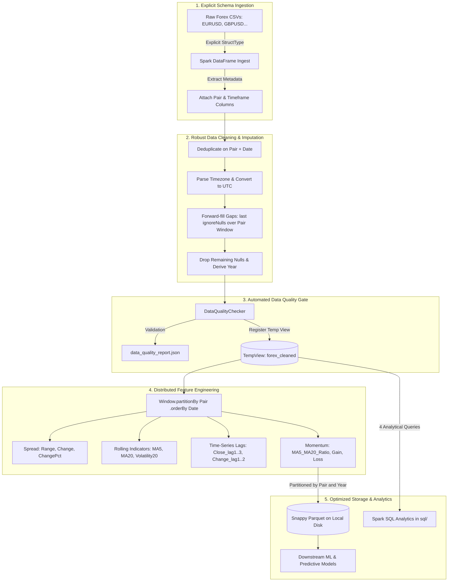

# Forex Distributed Data Engineering Pipeline

[](https://spark.apache.org/)
[](https://www.python.org/)
[-green.svg)](https://parquet.apache.org/)
[](https://airflow.apache.org/)
[-brightgreen.svg)](https://pytest.org/)

A production-grade, distributed big data ETL, feature engineering, and data quality pipeline for multi-year historical Foreign Exchange (Forex) OHLCV market data built with **PySpark**, **Apache Spark SQL**, **Parquet**, and **Apache Airflow**.

---

## Architecture Overview



---

## Key Data Engineering Highlights

* **Explicit Schema Enforcement:** Eliminates runtime type guessing overhead by applying strict `StructType` schemas across all ingested OHLCV CSVs.
* **Window Isolation Guarantee:** Guarantees zero cross-currency data bleeding by strictly enforcing `Window.partitionBy("Pair").orderBy("Date")` across all rolling moving averages (`MA5`, `MA20`), volatility calculations (`Volatility20`), and time-lag features (`Close_lag1..3`, `Change_lag1..2`).
* **Robust Temporal Imputation:** Handles weekend and market holiday closures using UTC timestamp alignment and windowed forward-fill (`last(..., ignoreNulls=True)`).
* **Parquet Partitioning Architecture:** Persists compressed columnar Snappy Parquet partitioned by `Pair` and `Year`. This completely bypasses the legacy Hadoop RPC client version incompatibility (`RPC response exceeds maximum data length`) that affected direct HDFS writes in earlier prototypes.
* **Automated Data Quality Gates:** Measures row count deltas across all stages, monitors null/NaN percentages per feature column, checks uniqueness constraints, and logs reports to `data_quality_report.json`.
* **Empirical Benchmarks:** Contains reproducible benchmarks comparing Pandas vs. PySpark preprocessing throughput across multiple scale tiers, and CSV vs. Parquet aggregation speeds.

---

## Measured Performance & Production Results

All measurements are empirical, recorded on an **Intel Core i9-13900HX** (24 physical cores / 32 threads, 15.63 GB RAM) running PySpark 4.2 (`local[*]`, 4 GB driver memory, 4 shuffle partitions):

### 1. End-to-End Pipeline Wall-Clock Duration

Processed **75,337 records** across **8 full years of trading data (2017–2024)**:

| Pipeline Stage | Run 1 (Cold JVM) | Run 2 (Warm) | Run 3 (Warm) | Mean Duration |
| :--- | :--- | :--- | :--- | :--- |
| **Phase 1: Ingestion** | 3.32 s | 0.27 s | 0.17 s | **1.25 s** |
| **Phase 2: Cleaning & Imputation** | 5.94 s | 2.67 s | 1.92 s | **3.51 s** |
| **Phase 3: Feature Engineering** | 0.94 s | 0.80 s | 0.69 s | **0.81 s** |
| **Phase 4: Data Quality Checks** | 7.99 s | 6.91 s | 6.79 s | **7.23 s** |
| **Phase 5: Partitioned Parquet Write** | 5.61 s | 3.81 s | 3.47 s | **4.30 s** |
| **Total Wall-Clock Pipeline Time** | **23.81 s** | **14.46 s** | **13.05 s** | **17.11 s** |

### 2. Parquet Storage Footprint & Compression

| Format & Scope | Schema | Disk Size | Ratio vs CSV | Compression Savings |
| :--- | :--- | :--- | :--- | :--- |
| **Raw Input CSVs** | 6 raw columns | 4.16 MB (4,365,811 B) | 1.00x (Baseline) | — |
| **Snappy Parquet (Same Schema)** | 6 raw columns | 2.35 MB (2,462,682 B) | **0.56x** | **43.59% reduction** |
| **Snappy Parquet (Feature Store)** | 24 columns | 8.17 MB (8,569,566 B) | **1.96x** | +18 indicators/lags |

* Directory Partitioning: `Pair={EURUSD, GBPUSD}/Year={2017..2024}` (9 leaf partition subdirectories, 9 snappy `.parquet` part files).

### 3. Preprocessing Throughput: Pandas vs. PySpark Across Scales

| Scale Tier | Dataset Scope | Rows | Engine | Mean Runtime |
| :--- | :--- | :--- | :--- | :--- |
| **(a) Single Hourly File** | EURUSD 1h | 70,128 | **Pandas**<br>**PySpark** | **0.1222 s**<br>3.9926 s (warm: ~1.82s) |
| **(b) All Hourly Files** | EURUSD 1h + GBPUSD 1h | 75,128 | **Pandas**<br>**PySpark** | **0.2124 s**<br>2.2328 s (warm: ~2.01s) |
| **(c) Full Multi-Timeframe** | EURUSD (1h, 1d) + GBPUSD (1h) | 75,337 | **Pandas**<br>**PySpark** | **0.1897 s**<br>2.0918 s (warm: ~1.78s) |

### 4. Analytical Read + GroupBy Aggregation (CSV vs. Parquet)
Query: `groupBy("Pair", "Year").agg(avg("Close"))` across the entire 75,337 row dataset:
- **Raw CSV Read + GroupBy:** 0.6027 s mean (warm: 0.3791 s)
- **Snappy Parquet Read + GroupBy:** **0.5499 s mean** (warm: **0.2648 s**) &rarr; **1.10x faster analytical throughput**

---

## Automated Data Quality Verification

Every pipeline run produces `data_quality_report.json`, verifying data integrity at every transformational boundary:

* **Row Count Reconciliation:** Raw Ingest (75,337) &rarr; Cleaned (75,337) &rarr; Features (75,337).
* **Deduplication:** 0 duplicate rows removed on `(Pair, Date)`.
* **Null Check:** 0 nulls in raw/cleaned stages; exactly 20 lag boundary nulls in features ($k \times \text{Pairs}$ lag warmup).
* **Schema Validation:** 24 of 24 expected columns verified valid (`passed: true`).
* **Temporal Coverage:** EURUSD from `2017-01-01` to `2024-12-31 23:00:00`; GBPUSD from `2017-01-01 00:00:00` to `2017-07-28 07:00:00`.
* **Anomaly Flagging:** 0 zero-volume bars; 21,515 weekend records cataloged for trading session filtering.

---

## Spark SQL Analytical Queries

The pipeline includes 4 Spark SQL analytical queries in `sql/` executed against the full partitioned Parquet output:

1. **`monthly_volatility.sql`** (2.28 s): Calculates monthly average Close, standard deviation (volatility), and average percentage change.
2. **`top_volatility_days.sql`** (0.83 s): Windowed ranking of top 10 volatile periods per pair by price range (`High - Low`) and relative percentage spread.
3. **`volume_aggregates.sql`** (0.44 s): Aggregates total traded volume, mean bar volume, and peak volume per pair and year.
4. **`row_count_reconciliation.sql`** (0.51 s): Verifies actual row counts, min/max timestamps, and distinct trading days per pair and year.

Run all queries:
```bash
python sql/run_queries.py
```

---

## Directory Structure

```
forex-data-pipeline/
├── src/
│   ├── spark_session.py        # Configured SparkSession factory (Windows & cluster ready)
│   ├── ingest.py               # Explicit schema reader with filename metadata extraction
│   ├── clean.py                # Deduplication, UTC conversion, partitioned forward-fill
│   ├── features.py             # MA5, MA20, Volatility20, lag features (all Pair-partitioned)
│   ├── quality.py              # Automated data quality checker & JSON report logger
│   ├── output.py               # Snappy Parquet partitioned exporter (by Pair and Year)
│   └── pipeline.py             # End-to-end pipeline orchestrator with stage timing
├── sql/
│   ├── monthly_volatility.sql       # Monthly average price, volatility, and returns
│   ├── top_volatility_days.sql      # Top 10 volatile periods per currency pair
│   ├── volume_aggregates.sql        # Traded volume totals and peaks by Pair and Year
│   ├── row_count_reconciliation.sql # Temporal consistency and row count reconciliation
│   └── run_queries.py               # Executes all 4 SQL queries against full Parquet output
├── benchmarks/
│   ├── run_benchmarks.py            # Multi-scale Pandas vs PySpark & CSV vs Parquet benchmarks
│   ├── measure_full_pipeline.py     # 3-run cold/warm stage latency and storage footprint profiler
│   └── pipeline_measurement_results.json
├── dags/
│   └── forex_batch_pipeline.py # Production Airflow DAG (ingest >> clean >> validate >> features >> parquet)
├── tests/
│   ├── conftest.py             # Shared SparkSession & mock time-series fixture
│   └── test_cleaning_and_features.py # Pytest unit tests (dedup, ffill, partition isolation)
├── data/
│   ├── raw/                    # Source OHLCV CSVs (EURUSD 1h/1d, GBPUSD 1h)
│   └── processed/parquet/      # Partitioned Snappy Parquet dataset (Pair=*/Year=*)
├── benchmarks.md               # Detailed empirical benchmark log
├── data_quality_report.json    # Automated data quality audit report
├── docker-compose.airflow.yml  # Docker Compose for Apache Airflow deployment
└── README.md
```

---

## Getting Started & Execution Guide

### 1. Prerequisites
* Python 3.10+ (tested on Python 3.12)
* Java 11, 17, or 25 LTS (with `winutils.exe` if running on Windows)
* Dependencies:
  ```bash
  pip install pyspark pandas pyarrow pytest psutil
  ```

### 2. Run the End-to-End Pipeline
```bash
python src/pipeline.py
```

### 3. Run Automated Unit Tests
```bash
pytest tests/ -v
```

### 4. Run Spark SQL Analytical Queries
```bash
python sql/run_queries.py
```

### 5. Run Performance Benchmarks
```bash
python benchmarks/run_benchmarks.py
```

### 6. Orchestrate with Apache Airflow
Launch the PostgreSQL metadata store, webserver, and scheduler:
```bash
docker compose -f docker-compose.airflow.yml up -d
```
Access the Airflow Web UI at `http://localhost:8080` (credentials: `admin` / `admin`).
*(Note: For distributed container execution of PySpark tasks, build an extended Airflow image with OpenJDK and PySpark, or point Airflow's `SparkSubmitOperator` to an external Spark cluster).*
