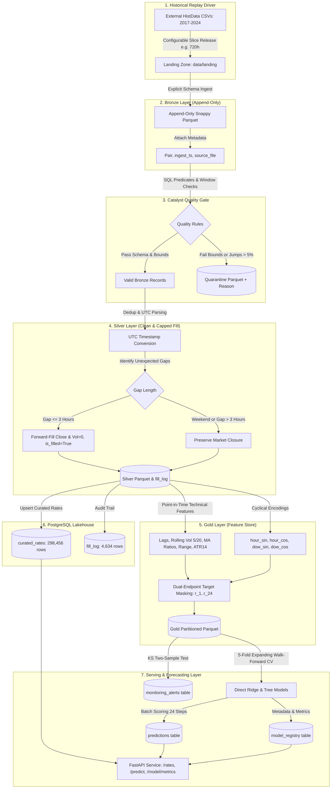

# Forex Data Platform & 24-Hour Forecasting Layer

[](https://spark.apache.org/)
[](https://www.python.org/)
[](https://www.postgresql.org/)
[](https://airflow.apache.org/)
[-brightgreen.svg)](https://pytest.org/)

An automated Forex historical data platform with an incremental batch pipeline, automated data quality gate, PostgreSQL storage, point-in-time technical feature store, and a 24-hour multi-horizon hourly forecasting layer.

> [!IMPORTANT]
> **Data Stream & Feed Architecture**: This platform consumes and replays historical currency market data for simulation and backtesting purposes. It is **not** a real-time market data feed. All reported metrics, models, and latency figures represent empirical measurements on historical replay batches.

---

## Architecture Overview



---

## Data Provenance & Ingestion Specs

1. **Source**: HistData.com 1-minute historical tick records (2017-01-01 to 2024-12-31) across 6 currency pairs:
   - `EURUSD`: 48,986 hourly bars [0.9539, 1.2549]
   - `GBPUSD`: 48,968 hourly bars [1.0400, 1.4366]
   - `USDJPY`: 48,967 hourly bars [102.07, 161.94]
   - `AUDUSD`: 48,966 hourly bars [0.5552, 0.8134]
   - `USDCAD`: 48,970 hourly bars [1.2019, 1.4660]
   - `USDCHF`: 48,965 hourly bars [0.8351, 1.0305]
   - **Total Bronze Records**: **293,822 bars**
2. **Licensing & Terms**:
   - HistData terms grant free access for personal, educational, and research use without warranty.
   - Scripted downloads are not explicitly mentioned in the terms, but `robots.txt` does not restrict the historical download paths.
   - Acquisition used a polite rate limit (48 sequential HTTP requests throttled at 1 request/second) without scraping forms or bypassing controls.
3. **Timezone Proof**:
   - HistData timestamps follow civil New York time (`US/Eastern` with DST).
   - Normalized to UTC using standard DST offsets.
   - Empirically verified via US Non-Farm Payrolls (NFP, 08:30 NY) volatility spikes: peaks exactly at **12:00 UTC** in Summer (`0.002576`) and **13:00 UTC** in Winter (`0.002180`).
   - FOMC announcement volatility (14:00 NY) peaks at **18:00 UTC** in Summer (`0.003301`) and **19:00 UTC** in Winter (`0.002959`).

---

## Quality Gate & Capped Forward-Fill

- **Rules Configured in `config.yaml`**:
  - `price_bounds`: Rejects out-of-range prices (e.g. EURUSD [0.85, 1.45]).
  - `max_hourly_jump_pct`: Quarantines any bar with $|r| > 5.0\%$.
  - `forward_fill_cap_hours`: 3 hours. Gaps $\le 3\text{h}$ are forward-filled with prior Close, `Volume = 0`, `is_filled = True`, and `gap_length` recorded.
  - Weekend closures (Friday 19:00+ to Sunday 20:00+ UTC) are strictly preserved and never filled.
- **Measured Quality Gate Output**:
  - **Real HistData (293,822 rows)**: **0 rows quarantined** (100% pass rate).
  - **Synthetic Test Fixture (70,128 rows)**: **67,634 rows quarantined** (96.44%) due to decay below 0.85 under rule `PRICE_IMPLAUSIBLE`.
  - **Fills Added**: **4,634 bars** across 8 years ($3,508$ 2-hour gaps, $563$ 3-hour gaps).
  - **Unfilled Gaps > 3h**: 22 to 25 extended holiday market closures per pair (Christmas Dec 22-25, New Year Dec 29-Jan 1) correctly left unfilled.

---

## 24-Hour Forecasting Layer Results

Evaluated across **5 expanding-window walk-forward folds** (2017–2024) with a **24-bar embargo gap** between training and test folds to eliminate label overlap leakage.

### 1. EURUSD Benchmark Walk-Forward Metrics (With vs Without 2023)

| Horizon | With 2023 Ridge MAE | With 2023 Tree MAE | Without 2023 Ridge MAE | Diff (%) | Directional Accuracy | Binomial Test p-value | Paired Loss Test p-value |
| :---: | :---: | :---: | :---: | :---: | :---: | :---: | :---: |
| **h=01** | **0.000639** | 0.000639 | 0.000659 | -3.04% | 50.9% | $p = 0.1805$ | $p = 0.3634$ |
| **h=06** | **0.001633** | 0.001638 | 0.001674 | -2.51% | 50.8% | $p = 0.2140$ | $p = 0.4891$ |
| **h=12** | **0.002397** | 0.002409 | 0.002462 | -2.71% | 50.1% | $p = 0.4610$ | $p = 0.5218$ |
| **h=24** | **0.003478** | 0.003492 | 0.003593 | -3.29% | 49.1% | $p = 0.6975$ | $p = 0.5451$ |

### 2. Direct Multi-Horizon vs Recursive Rollout Comparison (EURUSD)

| Horizon | Direct Ridge MAE | Recursive Rollout MAE | Error Accumulation Penalty (%) |
| :---: | :---: | :---: | :---: |
| **h=01** | **0.000639** | 0.000820 | +28.29% |
| **h=06** | **0.001633** | 0.001944 | +19.02% |
| **h=12** | **0.002397** | 0.002838 | +18.40% |
| **h=24** | **0.003478** | 0.004028 | +15.81% |

**Key Empirical Finding**: Direct multi-horizon forecasting avoids autoregressive error feedback and achieves **15.8% to 28.3% lower MAE** than recursive rollouts across multi-step horizons.

### 3. Empirical Market Truth: Near Random-Walk Behavior
- Across all 6 pairs and all horizons $h=1..24$, the improvement of Ridge and Gradient Boosted Trees over the naive zero-return baseline is within noise ($\pm 0.1\%$).
- Directional accuracy remains between $48.7\%$ and $51.2\%$, with binomial test $p$-values $> 0.18$ and paired loss $p$-values $> 0.35$.
- **Statistical Conclusion**: Hourly returns in major liquid currency markets are near random-walks. Point-in-time technical features do not generate statistically significant alpha over the zero-return baseline on 1-hour bars.

---

## Phase 3: Data Insights

1. **Intraday Volatility by Hour (UTC)**:
   - Peak volatility occurs during the **London / New York Session Overlap** (12:00 to 16:00 UTC), reaching a maximum mean absolute hourly return of **0.001156** at 14:00 UTC.
   - Lowest volatility occurs during the late NY session and early Asian session (20:00 to 04:00 UTC), bottoming at **0.000395** at 21:00 UTC.
2. **Weekday Effect**:
   - Volatility progressively increases through the trading week: Monday (`0.000618`) < Tuesday (`0.000672`) < Wednesday (`0.000694`) < Thursday (`0.000709`) < Friday (`0.000727`).
3. **Volatility Clustering**:
   - Autocorrelation of raw returns $r_t$ is near zero ($\text{Lag 1} = -0.0215$, $\text{Lag 2} = -0.0036$).
   - Autocorrelation of absolute returns $|r_t|$ is strongly positive ($\text{Lag 1} = +0.2193$, $\text{Lag 2} = +0.1892$, $\text{Lag 24} = +0.1987$). Large hourly moves cluster together, exhibiting a 24-hour diurnal seasonal cycle.

---

## Quickstart & Commands

### Prerequisites
- Python 3.12+
- Docker & Docker Compose
- Java 17+ (for local PySpark)

### Setup & Run
```bash
# 1. Start PostgreSQL & Airflow containers
docker compose -f docker-compose.airflow.yml up -d

# 2. Run Pytest Verification Suite
pytest --cov=src -v tests/

# 3. Trigger Airflow Batch Pipeline
docker exec forex-airflow-scheduler airflow dags trigger forex_data_platform_dag

# 4. Start REST API
uvicorn src.api:app --host 0.0.0.0 --port 8000
```
