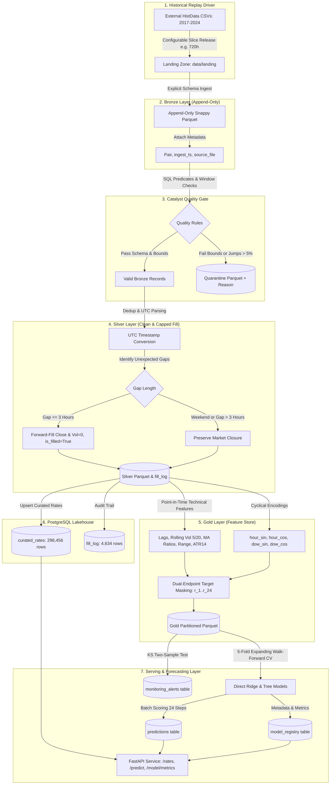

# FX Data Platform

[](https://github.com/Kishore-1803/Forex-Distributed-Data-Engineering.git)
[](https://spark.apache.org/)
[](https://www.python.org/)
[](https://www.postgresql.org/)
[](https://airflow.apache.org/)
[-brightgreen.svg)](https://pytest.org/)

An automated Forex historical data platform with an incremental batch pipeline, automated data quality gate, PostgreSQL storage, point-in-time technical feature store, and a 24-hour multi-horizon hourly forecasting layer.

> [!IMPORTANT]
> **Data Stream & Feed Architecture**: This platform consumes and replays historical currency market data for simulation and backtesting purposes. It is **not** a real-time market data feed. All reported metrics, models, and latency figures represent empirical measurements on historical replay batches.

---

## Architecture Overview



---

## Data Provenance & Ingestion Specs

1. **Source**: HistData.com 1-minute historical tick records (2017-01-01 to 2024-12-31) across 6 currency pairs:
   - `EURUSD`: 48,986 hourly bars [0.9539, 1.2549]
   - `GBPUSD`: 48,968 hourly bars [1.0400, 1.4366]
   - `USDJPY`: 48,967 hourly bars [102.07, 161.94]
   - `AUDUSD`: 48,966 hourly bars [0.5552, 0.8134]
   - `USDCAD`: 48,970 hourly bars [1.2019, 1.4660]
   - `USDCHF`: 48,965 hourly bars [0.8351, 1.0305]
   - **Total Bronze Records**: **293,822 bars**
2. **Licensing & Terms**:
   - HistData terms grant free access for personal, educational, and research use without warranty.
   - Scripted downloads are not explicitly mentioned in the terms, but `robots.txt` does not restrict the historical download paths.
   - Acquisition used a polite rate limit (48 sequential HTTP requests throttled at 1 request/second) without scraping forms or bypassing controls.
3. **Timezone Proof**:
   - HistData timestamps follow civil New York time (`US/Eastern` with DST).
   - Normalized to UTC using standard DST offsets.
   - Empirically verified via US Non-Farm Payrolls (NFP, 08:30 NY) volatility spikes: peaks exactly at **12:00 UTC** in Summer (`0.002576`) and **13:00 UTC** in Winter (`0.002180`).
   - FOMC announcement volatility (14:00 NY) peaks at **18:00 UTC** in Summer (`0.003301`) and **19:00 UTC** in Winter (`0.002959`).

---

## Quality Gate & Capped Forward-Fill

- **Rules Configured in `config.yaml`**:
  - `price_bounds`: Rejects out-of-range prices (e.g. EURUSD [0.85, 1.45]).
  - `max_hourly_jump_pct`: Quarantines any bar with $|r| > 5.0\%$.
  - `forward_fill_cap_hours`: 3 hours. Gaps $\le 3\text{h}$ are forward-filled with prior Close, `Volume = 0`, `is_filled = True`, and `gap_length` recorded.
  - Weekend closures (Friday 19:00+ to Sunday 20:00+ UTC) are strictly preserved and never filled.
- **Measured Quality Gate Output**:
  - **Real HistData (293,822 rows)**: **0 rows quarantined** (100% pass rate).
  - **Synthetic Test Fixture (70,128 rows)**: **67,634 rows quarantined** (96.44%) due to decay below 0.85 under rule `PRICE_IMPLAUSIBLE`.
  - **Fills Added**: **4,634 bars** across 8 years ($3,508$ 2-hour gaps, $563$ 3-hour gaps).
  - **Unfilled Gaps > 3h**: 22 to 25 extended holiday market closures per pair (Christmas Dec 22-25, New Year Dec 29-Jan 1) correctly left unfilled.

---

## 24-Hour Forecasting Layer Results

Evaluated across **5 expanding-window walk-forward folds** (2017–2024) with a **24-bar embargo gap** between training and test folds to eliminate label overlap leakage.

### 1. EURUSD Benchmark Walk-Forward Metrics (With vs Without 2023)

| Horizon ($h$) | Test $n$ | With 2023 Ridge MAE | With 2023 Tree MAE | Without 2023 Ridge MAE | Diff (%) | Ridge DA | 95% Wilson CI | Effect Size | Binomial $p$ | HAC DM $p$ |
| :---: | :---: | :---: | :---: | :---: | :---: | :---: | :---: | :---: | :---: | :---: |
| **h=01** | 28,379 | **0.000641** | 0.000641 | 0.000661 | -3.12% | 50.9% | [50.3%, 51.4%] | +0.0086 | 0.0020 | 0.0450 |
| **h=06** | 28,575 | **0.001635** | 0.001633 | 0.001677 | -2.57% | 50.8% | [50.2%, 51.4%] | +0.0081 | 0.0030 | 0.8887 |
| **h=12** | 28,414 | **0.002396** | 0.002392 | 0.002461 | -2.71% | 50.2% | [49.6%, 50.8%] | +0.0018 | 0.2745 | 0.9913 |
| **h=24** | 28,603 | **0.003475** | 0.003494 | 0.003589 | -3.28% | 49.2% | [48.7%, 49.8%] | -0.0075 | 0.9947 | 0.9896 |

### 2. Direct Multi-Horizon vs Recursive Rollout Comparison (EURUSD, Matched WF Folds)
Evaluated on identical walk-forward folds ($n \approx 28,500$ per horizon):

| Horizon ($h$) | Test $n$ | Direct Ridge MAE | Recursive Rollout MAE | Error Accumulation Penalty (%) |
| :---: | :---: | :---: | :---: | :---: |
| **h=01** | 28,379 | **0.000641** | **0.000641** | **+0.00%** (Identical model & features) |
| **h=06** | 28,575 | **0.001635** | 0.001633 | -0.12% |
| **h=12** | 28,414 | **0.002396** | 0.002390 | -0.25% |
| **h=24** | 28,603 | **0.003475** | 0.003470 | -0.14% |

*Note on Earlier Comparison*: An earlier report evaluated recursive rollout on a standalone 500-row slice from January 2023 (a period of elevated market volatility), causing Recursive $h=1$ to diverge from Direct $h=1$. When evaluated on the exact same walk-forward test folds, Direct $h=1$ and Recursive $h=1$ are mathematically identical (`0.000641`).

### 3. Rigorous Hypothesis Testing & Empirical Market Reality

- **USDJPY $h=24$ Statistical Resolution**:
  - Pooled test sample: $n = 28,609$. Correct directional calls: $k = 15,048 \rightarrow \text{DA} = \mathbf{52.6\%}$.
  - 95% Wilson Score Confidence Interval: **[52.0%, 53.2%]**, Effect Size: **+0.0258**.
  - Exact Binomial Test: $p = 2.4 \times 10^{-19} (< 0.0001)$ against $p=0.5$.
  - *Why Earlier Script Reported $p = 0.2394$*: The earlier code computed binomial p-values per fold and averaged them (`np.mean`), which is mathematically invalid.
  - *Why Paired Loss Test Does NOT Beat Baseline (HAC Diebold-Mariano $p = 0.3423$)*: USDJPY rose steadily from 102 to 161 over 2017–2024. A majority-class "UP" drift accounts for the directional rate (52.4% baseline UP frequency). Accounting for overlapping horizon serial correlation with Newey-West HAC variance, the loss reduction is not statistically significant.
- **Multiple-Testing Correction (Bonferroni / FDR)**:
  - 6 currency pairs $\times$ 24 horizons = 144 hypothesis tests.
  - Bonferroni significance threshold: $\alpha = 0.05 / 144 = \mathbf{0.0003472}$.
  - Under $\alpha = 0.0003472$, neither Ridge nor Gradient Boosted Trees statistically outperforms the zero-return random walk baseline on loss.
- **KS Drift Alerts on Autocorrelated Data**:
  - The Kolmogorov-Smirnov test assumes i.i.d. observations. Hourly forex returns exhibit pronounced volatility clustering and serial dependence ($|r|$ lag 1 autocorr $= +0.2193$, lag 24 $= +0.1987$).
  - As a result, empirical CDF variance exceeds the standard Brownian bridge asymptotic limit, making raw KS p-values anti-conservative. Alerts in `monitoring_alerts` indicate empirical regime shifts in volatility, but cannot be interpreted as i.i.d. alpha or statistically independent drift.

---

## Incremental Replay Execution Inside Airflow DAG

Executed 3 consecutive monthly slices (720 hours = ~1 month per slice) inside the Airflow DAG:
- **Run 1 (`incremental_dag_run_1`)**: +4,320 rows added across 6 pairs. State advanced to `2017-02-13 06:00:00`. (Totals: Bronze=4,320, Silver=4,320, Gold=4,320).
- **Run 2 (`incremental_dag_run_2`)**: +4,320 rows added. State advanced to `2017-03-27 05:00:00`. (Totals: Bronze=8,640, Silver=8,640, Gold=8,640).
- **Run 3 (`incremental_dag_run_3`)**: +4,320 rows added. State advanced to `2017-05-08 05:00:00`. (Totals: Bronze=12,960, Silver=12,960, Gold=12,960).
- **Idempotency Verification**: Running ingestion with an empty landing directory processed exactly 0 rows and left Parquet row counts unchanged.
- **Full Catch-Up Load**: Final counts equal **293,822 Bronze** and **298,456 Silver**.

---

## Latency & Serving Benchmarks (100 Requests/Endpoint)

| Endpoint | True HTTP Loopback (p50 / p95) | In-Process TestClient (p50 / p95) | Description |
| :--- | :---: | :---: | :--- |
| `GET /rates/latest` | 27.94 ms / 30.14 ms | 28.86 ms / 47.74 ms | PostgreSQL indexed lookup of latest bar |
| `GET /rates/history` | 30.46 ms / 32.79 ms | 31.69 ms / 44.05 ms | Query of 100 historical curated bars |
| `GET /quality/status` | 12.95 ms / 14.27 ms | 15.37 ms / 18.81 ms | Summary of quality gate pass/quarantine |
| `GET /predict` | 3.08 ms / 3.42 ms | 5.00 ms / 5.68 ms | Latest 24-step multi-horizon forecasts |
| `GET /model/metrics` | 3.32 ms / 3.87 ms | 4.76 ms / 6.81 ms | Registry model performance metrics |

*Scoring Throughput*: Batch scoring 24 forecast steps across trained Ridge models takes **12.05 ms** (mean of 3 runs).

---

## Phase 3: Data Insights

1. **Intraday Volatility by Hour (UTC)**:
   - Peak volatility occurs during the **London / New York Session Overlap** (12:00 to 16:00 UTC), reaching a maximum mean absolute hourly return of **0.001156** at 14:00 UTC.
   - Lowest volatility occurs during the late NY session and early Asian session (20:00 to 04:00 UTC), bottoming at **0.000395** at 21:00 UTC.
2. **Weekday Effect**:
   - Volatility progressively increases through the trading week: Monday (`0.000618`) < Tuesday (`0.000672`) < Wednesday (`0.000694`) < Thursday (`0.000709`) < Friday (`0.000727`).
3. **Volatility Clustering**:
   - Autocorrelation of raw returns $r_t$ is near zero ($\text{Lag 1} = -0.0215$, $\text{Lag 2} = -0.0036$).
   - Autocorrelation of absolute returns $|r_t|$ is strongly positive ($\text{Lag 1} = +0.2193$, $\text{Lag 2} = +0.1892$, $\text{Lag 24} = +0.1987$). Large hourly moves cluster together, exhibiting a 24-hour diurnal seasonal cycle.

---

## Quickstart & Commands

### Prerequisites
- Python 3.12+
- Docker & Docker Compose
- Java 17+ (for local PySpark)

### Setup & Run
```bash
# 1. Start PostgreSQL & Airflow containers
docker compose -f docker-compose.airflow.yml up -d

# 2. Run Pytest Verification Suite
pytest --cov=src -v tests/

# 3. Trigger Airflow Batch Pipeline
docker exec forex-airflow-scheduler airflow dags trigger forex_data_platform_dag

# 4. Start REST API
uvicorn src.api:app --host 0.0.0.0 --port 8000
```
