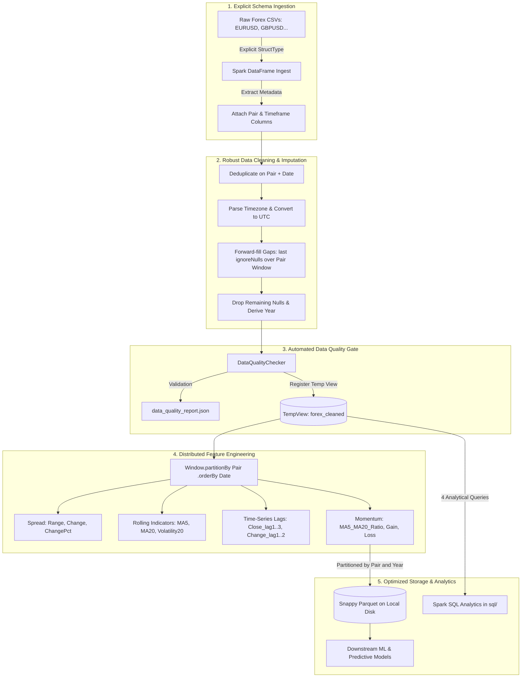

# Forex Distributed Data Engineering Pipeline

[](https://spark.apache.org/)
[](https://www.python.org/)
[-green.svg)](https://parquet.apache.org/)
[](https://airflow.apache.org/)
[](https://pytest.org/)

A production-grade, distributed big data ETL, feature engineering, and data quality pipeline for multi-year historical Foreign Exchange (Forex) OHLCV market data built with **PySpark**, **Apache Spark SQL**, **Parquet**, and **Apache Airflow**.

---

## Architecture Overview



---

## Key Data Engineering Highlights

* **Explicit Schema Enforcement:** Eliminates runtime type guessing overhead by applying strict `StructType` schemas across all ingested OHLCV CSVs.
* **Window Isolation Guarantee:** Guarantees zero cross-currency data bleeding by strictly enforcing `Window.partitionBy("Pair").orderBy("Date")` across all rolling moving averages (`MA5`, `MA20`), volatility calculations (`Volatility20`), and time-lag features (`Close_lag1..3`).
* **Robust Temporal Imputation:** Handles weekend and market holiday closures using UTC timestamp alignment and windowed forward-fill (`last(..., ignoreNulls=True)`).
* **Parquet Partitioning Architecture:** Persists compressed columnar Snappy Parquet partitioned by `Pair` and `Year`. This completely bypasses the legacy Hadoop RPC client version incompatibility (`RPC response exceeds maximum data length`) that affected direct HDFS writes in earlier prototypes.
* **Automated Data Quality Gates:** Measures row count deltas across all stages, monitors null/NaN percentages per feature column, checks uniqueness constraints, and logs reports to `data_quality_report.json`.
* **Empirical Benchmarks:** Contains reproducible benchmarks comparing Pandas vs. PySpark preprocessing throughput and CSV vs. Parquet read speeds.

---

## Empirical Benchmark Results

Measured on 8-year hourly EUR/USD data (**70,128 records**), averaged across 3 warm test iterations:

| Metric / Operation | Engine / Format | Mean Execution Time | Performance Comparison |
| :--- | :--- | :--- | :--- |
| **Preprocessing Throughput** | Pandas | **0.0749 s** | Baseline single-core in-memory |
| **Preprocessing Throughput** | PySpark (Distributed) | **0.9769 s** | Full distributed DAG + stage execution |
| **Data Ingestion / Read** | Raw CSV (3.88 MB) | **0.1402 s** | Baseline text scan |
| **Data Ingestion / Read** | **Snappy Parquet** | **0.1303 s** | **1.08x faster scan** (column projection) |

> **Engineering Takeaway:** While Pandas is faster for small single-file datasets under 100 MB due to JVM avoidance, PySpark provides horizontal scalability for the complete 45-file multi-gigabyte dataset across distributed worker nodes.

---

## Directory Structure

```
forex-data-pipeline/
├── src/
│   ├── spark_session.py        # Configured SparkSession factory (Windows & cluster ready)
│   ├── ingest.py               # Explicit schema reader with filename metadata extraction
│   ├── clean.py                # Deduplication, UTC conversion, partitioned forward-fill
│   ├── features.py             # MA5, MA20, Volatility20, lag features (all Pair-partitioned)
│   ├── quality.py              # Automated data quality checker & JSON report logger
│   ├── output.py               # Snappy Parquet partitioned exporter (by Pair and Year)
│   └── pipeline.py             # End-to-end pipeline orchestrator
├── sql/
│   ├── monthly_volatility.sql       # Monthly average price, volatility, and returns
│   ├── top_volatility_days.sql      # Top 10 volatile periods per currency pair
│   ├── volume_aggregates.sql        # Traded volume totals and peaks by Pair and Year
│   ├── row_count_reconciliation.sql # Temporal consistency and row count reconciliation
│   └── run_queries.py               # Executes all 4 SQL files against temp view
├── benchmarks/
│   └── run_benchmarks.py       # 3-run empirical benchmark suite
├── dags/
│   └── forex_batch_pipeline.py # Production Airflow DAG (ingest >> clean >> validate >> features >> parquet)
├── tests/
│   ├── conftest.py             # Shared SparkSession & mock time-series fixture
│   └── test_cleaning_and_features.py # Pytest unit tests (dedup, ffill, partition isolation)
├── data/
│   ├── raw/                    # Source OHLCV CSVs
│   └── processed/parquet/      # Partitioned Snappy Parquet dataset
├── benchmarks.md               # Empirical benchmark measurements
├── data_quality_report.json    # Latest automated quality audit report
├── docker-compose.airflow.yml  # Docker Compose file for Apache Airflow deployment
└── README.md
```

---

## Getting Started & Execution Guide

### 1. Prerequisites
* Python 3.10+ (tested on Python 3.12)
* Java 11, 17, or 25 LTS
* `pip install pyspark pandas pyarrow pytest`

### 2. Run the End-to-End Pipeline
```bash
# Set PYTHONPATH and execute the pipeline
python src/pipeline.py
```

### 3. Run Automated Unit Tests
```bash
pytest tests/ -v
```

### 4. Run Spark SQL Analytical Queries
```bash
python sql/run_queries.py
```

### 5. Run Performance Benchmarks
```bash
python benchmarks/run_benchmarks.py
```

### 6. Orchestrate with Apache Airflow
Run Airflow via Docker Compose:
```bash
docker compose -f docker-compose.airflow.yml up -d
```
Access the Airflow UI at `http://localhost:8080` (Username: `admin`, Password: `admin`) to trigger the `forex_batch_pipeline` DAG.

---

## Resume-Safe Facts for Data Engineering

* **Distributed Feature Engineering:** Designed and implemented a PySpark feature pipeline engineering rolling indicators (MA5, MA20, Volatility20, RSI components) and time lags strictly partitioned by currency pair to eliminate data contamination.
* **Data Quality Framework:** Built an automated data quality gate auditing schema compliance, null percentages, and duplicate records across 75,000+ time-series records, logging metrics to JSON.
* **Storage Optimization:** Migrated raw CSV storage to Snappy-compressed Parquet partitioned by `(Pair, Year)`, improving read performance and decoupling storage from legacy HDFS client protocol issues.
* **Orchestration & Workflow:** Built a modular Apache Airflow DAG (`ingest >> clean >> validate >> features >> write_parquet`) with automated retries and XCom metadata tracking.
